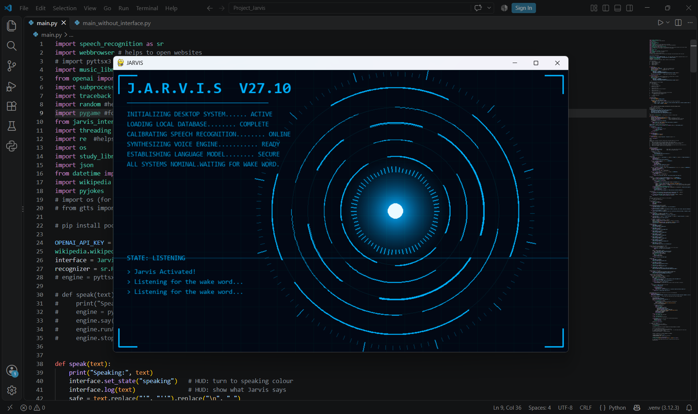

# J.A.R.V.I.S

A voice assistant I built in Python for a school competition.

Like most people, I watched Tony Stark talk to Jarvis in the Iron Man movies and thought, okay, I want one of those. Mine can't fly a suit, but it can open YouTube, tell you the time, read out a Wikipedia summary, and run a study timer while a glowing arc reactor spins on your screen. It's not as smart as the movie one, obviously. But it's mine, and I built it.

I'm still learning Python, so a lot of this was trial and error. The first version just printed text in the terminal. Everything else got added one piece at a time after that.


*This is the screen while Jarvis is listening for its wake word.*

---

## How you use it

Run the program, wait for Jarvis to say "Jarvis Activated", then say **"Jarvis"**. It answers "yes sir", and then you give it one command. After it's done, it goes back to waiting for the wake word.

That's really the whole idea. Here's what you can ask it:

| You say | What happens |
|---|---|
| "play stealth" | Opens that song on YouTube (the songs live in `music_library.py`) |
| "open youtube" | Also works for google, gmail, facebook, linkedin, instagram and ncert |
| "bbc news", "cnn news", "ndtv news" | Opens the news site |
| "nobel prize" | Opens the list of Nobel Prize winners |
| "school" | Opens my school's website |
| "tell me about black holes" | Reads the first two sentences from Wikipedia ("wikipedia black holes" works too) |
| "what time is it" | Tells you the time |
| "what day is it" | Tells you today's date |
| "tell me a joke" | Tells a random programming joke using the `pyjokes` library |
| "my name is Sam" | Remembers it, even after you close the program |
| "what's my name" | Tells you back |
| "my favorite song is stealth" | Saves it, and then "play my favorite song" plays it |
| "forget my name" | Removes just that one thing |
| "reset memory" | Wipes everything it remembers |
| "study mode" | Gives you a random motivational line |
| "start a 30 minute timer" | Starts a countdown (25 minutes if you don't say a number) |
| "stop the timer" | Cancels it |
| "open physics notes" | Opens your physics folder |
| "introduce yourself", "what can you do" | Jarvis talks about itself |
| "can you do my homework" | It politely says no, but offers to help you understand the topic |

If you say something it doesn't know, it says "Sorry, I cannot do that yet sir". Unless you've set up the ChatGPT part, which I explain further down.

---

## The screen

The window is built with pygame, and honestly it's my favourite part. There's a glowing core with rings that rotate around it, a grid in the background, a scanline that sweeps down, and some boot-up text that types itself out when you start.

The colour tells you what Jarvis is up to. Blue means it's idle, cyan means it's listening, amber means it's thinking (the rings spin faster too), and light blue means it's talking. The bars around the core move when it speaks.

On the left there's a little log that shows your last few commands and Jarvis's replies. When a study timer is running, the countdown shows up there as well. Press `Esc` or close the window to shut it all down.

---

## How it works

It's simpler than it looks.

1. A background thread keeps listening through your microphone.
2. Whatever you say gets turned into text by Google's speech recognition.
3. If the text has "jarvis" in it, Jarvis says "yes sir" and listens for your command.
4. `processCommand()` goes through a long list of `if / elif` checks until it finds the one that matches.
5. Jarvis answers out loud using the Windows built-in voice.

The listening runs in its own thread because pygame needs the main thread for the window. It took me a while to figure that out.

---

## Files in this repo

| File | What it's for |
|---|---|
| `main.py` | The main program, with the HUD window |
| `main_without_interface.py` | The exact same Jarvis, just without the HUD. More on that below |
| `jarvis_interface.py` | The animated screen |
| `music_library.py` | Song names and their YouTube links |
| `study_library.py` | Finds your study folders so Jarvis can open them |
| `microphone_test.py` | Quick check that your mic works |
| `mic_calibration_test.py` | Prints how noisy your room is, to help set the sensitivity |
| `user.py` | A tiny script I used to test the ChatGPT connection on its own |
| `requirements.txt` | The libraries |
| `jarvis_memory.json` | Gets created the first time you save something. It's Jarvis's memory |

### Two versions of Jarvis

`main.py` is the full thing with the HUD. `main_without_interface.py` is the same code with the window taken out, so it runs only in the terminal. I kept it because it's lighter, and because it's handy if pygame ever gives you trouble. Everything still works, the timer just counts quietly in the background instead of showing on screen.

---

## Setting it up

You need Windows, Python 3, a microphone and an internet connection.

```bash
pip install -r requirements.txt
pip install wikipedia pyjokes
```

The `requirements.txt` has a few extra libraries in it from things I tried and dropped along the way, so don't worry if you see some you don't recognise. If `PyAudio` won't install, try `pip install pipwin` and then `pipwin install pyaudio`.

Then:

```bash
python main.py
```

(or `python main_without_interface.py` for the version without the window)

### Things worth knowing

**It only works on Windows.** Jarvis's voice comes from PowerShell, and opening files uses `os.startfile`. Both are Windows things.

**Listening needs internet, speaking doesn't.** Turning your voice into text goes through Google. The voice that talks back is built into Windows. Wikipedia needs internet too.

**Microphone sensitivity.** In `main.py` there's a line `r.energy_threshold = 50`. A lower number makes Jarvis more sensitive. If it keeps missing you, or keeps reacting to noise that isn't you, change that number. Running `mic_calibration_test.py` in a quiet room helps you pick a sensible value.

---

## Making it yours

**Add a song.** Put one more line in `music_library.py`:

```python
"my song": "https://www.youtube.com/watch?v=xxxxxxxx",
```

Then say "play my song".

**Add study folders.** Make a folder called `materials` on your Desktop (or inside your OneDrive Desktop, or right next to the code). Every folder inside it becomes something Jarvis can open. A folder called `physics` can be opened with "open physics", "open physics notes", "open physics material" or "open physics folder". A few short names work too, so "math" opens `maths`, "chem" opens `chemistry` and "bio" opens `biology`. When you start the program, it prints which folder it found.

**Add a website.** Copy one of the `open ...` blocks in `processCommand()` in `main.py`, change the name and the link, and you're done.

---

## The ChatGPT part (optional)

There's a fallback that sends anything Jarvis doesn't understand to ChatGPT. It's off unless you give it an API key. To turn it on, set an environment variable called `OPENAI_API_KEY` on your computer, restart your terminal, and run Jarvis again. Don't paste your key into the code, because it's very easy to push it to GitHub by accident.

---

## A note on privacy

Jarvis's memory is stored in plain text in `jarvis_memory.json`, so anyone who can open your computer can read it. If other people use your PC, say "reset memory" when you're done.

---

## Stuff I tried and dropped

- **Hindi.** I wanted Jarvis to reply in Hindi when spoken to in Hindi, using gTTS. I decided to skip it for now. The gTTS code is still there, commented out.
- **pyttsx3 for the voice.** It worked at first, but I switched to the PowerShell voice instead.
- **My own jokes.** I first wrote six jokes by hand and picked one at random, but now Jarvis uses the `pyjokes` library instead. My old list and the code that used it are still in the file, commented out. If you'd rather have your own jokes, just un-comment them and comment out the `pyjokes` line.
- **Automatic mic calibration at startup.** I use a fixed sensitivity value now, because it felt more reliable for my room.

## What I'd add next

A to-do list, more songs, and more things it can do. Maybe Hindi again at some point.

---

## Why I made this

It started as a project for a school competition, but mostly I just wanted to build something I'd actually use. I broke it a lot, fixed it, and broke it again. That's honestly where I learned the most.

If you spot something I could do better, feel free to open an issue. I'm still learning, so be kind.

---

## Author

Created by YOUR NAME ([@MOHAMMAD FARAZ IDREESI](https://github.com/morrhez)).

If you use or build on this project, I'd love to hear about it!

## License

This project is licensed under the Apache License 2.0. You are free to use, modify, and distribute this project in accordance with the terms of the licence.

See the [LICENSE](LICENSE) file for the full licence text.

---

*Made with Python, pygame, and a lot of trial and error.*
